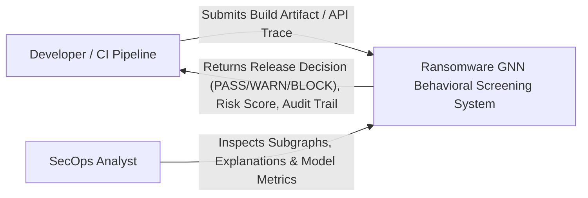
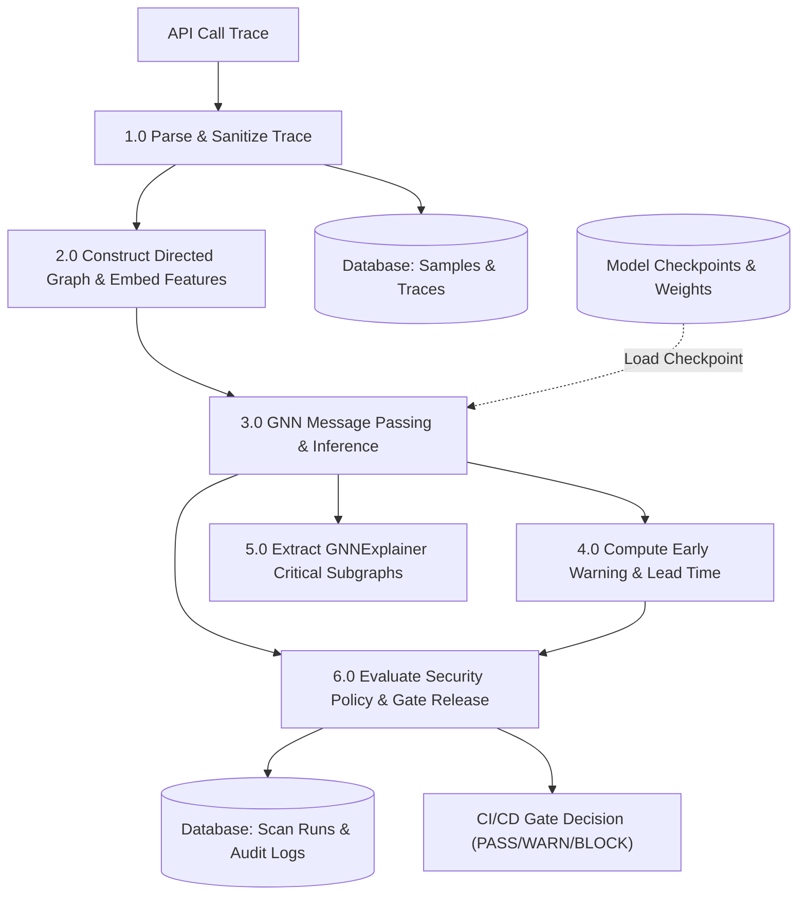
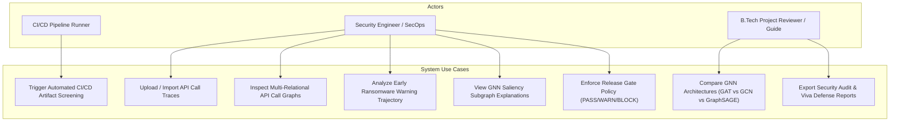
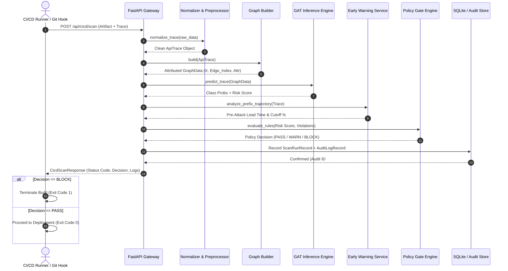
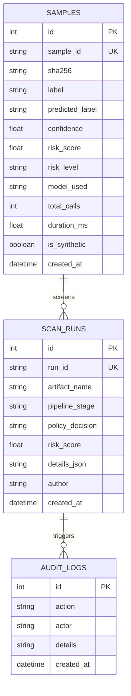

# System Architecture and Design Diagrams

## 1. High-Level Logical System Architecture

```mermaid
flowchart TD
    subgraph Layer1["Layer 1: Data Ingestion & Import"]
        A1["Raw Trace Upload (JSON/CSV)"]
        A2["Synthetic Kill-Chain Generator"]
        A3["Pre-Packaged CI/CD Fixtures"]
    end

    subgraph Layer2["Layer 2: Preprocessing & PASAC Categorization"]
        B1["API Normalizer & Canonicalizer"]
        B2["PII / Path Sanitizer"]
        B3["PASAC Sensitive API Tagger (8 Categories)"]
    end

    subgraph Layer3["Layer 3: Multi-Relational Graph Construction"]
        C1["Sequential Temporal Edges (i -> i+1)"]
        C2["Intra-Thread Continuity Edges"]
        C3["Shared Resource Dependency Edges"]
        C4["14-Dimensional Attributed Node Feature Matrix"]
    end

    subgraph Layer4["Layer 4: GNN Detection & Behavioral Modeling"]
        D1["Graph Attention Network (GAT)"]
        D2["Graph Convolutional Network (GCN)"]
        D3["GraphSAGE"]
        D4["Dual Global Pooling (Mean + Max)"]
        D5["Multi-Class Softmax Classifier"]
    end

    subgraph Layer5["Layer 5: Behavioral Intelligence & Early Warning"]
        E1["Multi-Factor Security Risk Score (0 - 100)"]
        E2["Prefix Trajectory Analysis (PASAC Lead Time)"]
        E3["GNNExplainer Gradient Saliency & Critical Subgraphs"]
    end

    subgraph Layer6["Layer 6: Cloud CI/CD Supply Chain Integration"]
        F1["Automated Release Policy Gate"]
        F2["Decision Matrix (PASS / WARN / BLOCK)"]
        F3["Immutable Audit Log & Tamper-Evident Store"]
    end

    subgraph Layer7["Layer 7: Full-Stack Web Dashboard & API"]
        G1["FastAPI REST Engine"]
        G2["Interactive Graph Canvas Explorer"]
        G3["Model Performance & Confusion Matrix View"]
        G4["Automated Markdown/JSON Audit Reports"]
    end

    Layer1 --> Layer2
    Layer2 --> Layer3
    Layer3 --> Layer4
    Layer4 --> Layer5
    Layer5 --> Layer6
    Layer6 --> Layer7
    Layer5 --> Layer7
```

---

## 2. Data Flow Diagram (DFD Level 0 & Level 1)

### Level 0 Context Diagram

### Level 1 Detailed DFD

---

## 3. Use-Case Diagram

---

## 4. Sequence Diagram: CI/CD Security Screening Workflow

---

## 5. Entity-Relationship (ER) Diagram

---

## 6. Model Training and Evaluation Pipeline

```mermaid
flowchart LR
    D1["Corpus: 240 Structured Traces"] --> S1["Stratified Split: 70% Train / 15% Val / 15% Test"]
    S1 --> G1["GraphBuilder: Build Disjoint Batched Graphs"]
    G1 --> T1["Batched Forward Pass (X, Edge_Index, Batch)"]
    T1 --> L1["CrossEntropy Loss + L2 Regularization"]
    L1 --> B1["Backpropagation & AdamW Optimizer"]
    B1 --> V1["Validation Epoch Evaluation (Early Stopping)"]
    V1 --> C1["Save Best Checkpoint (.pt)"]
    C1 --> E1["Held-Out Test Evaluation"]
    E1 --> M1["Compute Confusion Matrix, Precision, Recall, F1, ROC-AUC, Latency"]
```

